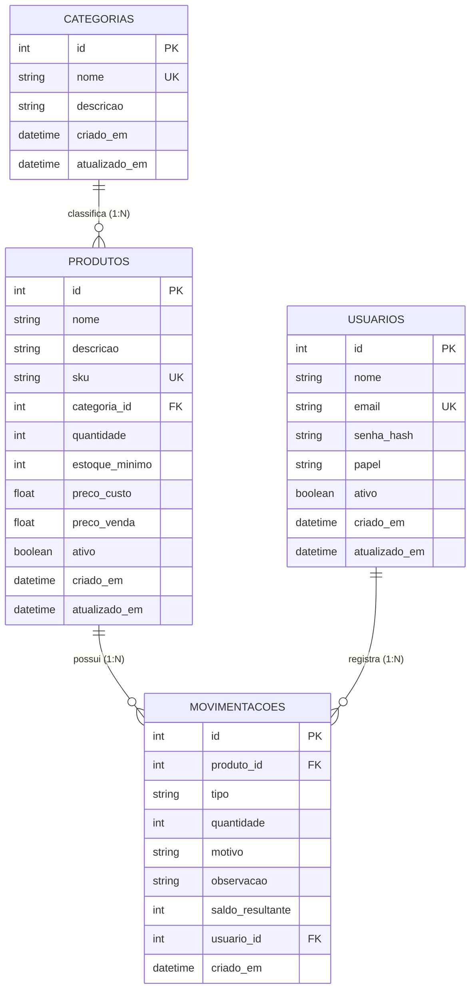

# Documentação Técnica — Projeto 3: Sistema de Controle de Estoque (EstoquePro)

> **Objetivo deste arquivo:** Reunir todos os entregáveis exigidos no documento *Projetos de Banco de Dados Relacional* (Etapas 1 a 6 e Checklist de Entrega) para compor o documento final em formatação ABNT e apoiar a apresentação do sistema.

---

## 1. Enunciado Interpretado e Requisitos Funcionais

### 1.1 Interpretação do Problema
Uma loja de pequeno porte realiza o controle de seus produtos de forma manual, o que dificulta:
- Saber a quantidade disponível de cada item em tempo real;
- Identificar produtos com estoque baixo ou zerado;
- Acompanhar o histórico de entradas e saídas de mercadorias;
- Garantir que saídas não ultrapassem o saldo disponível.

A solução desenvolvida (**EstoquePro**) é uma aplicação web com banco de dados relacional que centraliza o cadastro de **categorias**, **produtos**, **movimentações de estoque** e **usuários**, garantindo integridade referencial, histórico imutável de operações e atualização automática de saldos.

### 1.2 Lista de Requisitos Funcionais (RF)
| Código | Requisito Funcional (PDF) | Implementação no EstoquePro |
| :--- | :--- | :--- |
| **RF01** | Cadastrar, consultar, editar e excluir categorias. | Tela *Categorias* (`/api/categorias`), com bloqueio de exclusão caso existam produtos vinculados (`ON DELETE RESTRICT`). |
| **RF02** | Cadastrar, consultar, editar e excluir/arquivar produtos. | Tela *Produtos* (`/api/produtos`), com SKU único e arquivamento seguro quando o item já possui histórico. |
| **RF03** | Consultar produtos por nome ou categoria. | Busca por nome/descrição/SKU, filtro por categoria, situação do estoque e ordenação em `produtos.service.ts`. |
| **RF04** | Registrar entradas e saídas de estoque. | Tela *Movimentar Estoque* (`/api/movimentacoes`), com seleção de produto, tipo (`ENTRADA` ou `SAIDA`), quantidade, motivo e observação. |
| **RF05** | Atualizar a quantidade disponível após cada movimentação. | Atualização atômica dentro de transação SQL (`$transaction`) em `movimentacoes.service.ts`, gravando também o `saldo_resultante`. |
| **RF06** | Exibir a lista de produtos com estoque baixo. | Tela *Alertas* (`/api/alertas`), filtro de situação (`BAIXO` / `SEM_ESTOQUE`) e relatório dedicado. |
| **RF07** | Consultar o histórico de movimentações de cada produto. | Tela *Histórico* (`/api/movimentacoes`) e aba/detalhes do produto, com filtros por produto, categoria, tipo e período. |

### 1.3 Regras de Negócio (RN)
- **RN01 — Associação obrigatória:** Todo produto deve pertencer a uma categoria existente (`categoria_id` `NOT NULL` com `FOREIGN KEY`).
- **RN02 — Quantidade positiva nas movimentações:** É proibido registrar entradas ou saídas com quantidade menor ou igual a zero (validado no front-end, na API via Zod e no banco via `CHECK (quantidade > 0)`).
- **RN03 — Bloqueio de saída sem saldo:** É proibido registrar saída em quantidade superior ao estoque disponível (validado na API dentro da transação e no banco via `CHECK (quantidade >= 0)`).
- **RN04 — Rastreabilidade:** Toda movimentação registra o produto envolvido, tipo (`ENTRADA` ou `SAIDA`), quantidade, data/hora (`criado_em`), saldo resultante e usuário responsável.

---

## 2. Modelo Conceitual (DER e Cardinalidades)

### 2.1 Entidades e Atributos
1. **Usuario**: `id` (PK), `nome`, `email`, `senha_hash`, `papel`, `ativo`, `criado_em`, `atualizado_em`.
2. **Categoria**: `id` (PK), `nome`, `descricao`, `criado_em`, `atualizado_em`.
3. **Produto**: `id` (PK), `nome`, `descricao`, `sku`, `quantidade`, `estoque_minimo`, `preco_custo`, `preco_venda`, `ativo`, `criado_em`, `atualizado_em`.
4. **Movimentacao**: `id` (PK), `tipo`, `quantidade`, `motivo`, `observacao`, `saldo_resultante`, `criado_em`.

### 2.2 Relacionamentos e Cardinalidades
- **Categoria — Produto (`1:N`)**: Uma categoria pode possuir **zero ou muitos** produtos (`0..N`), e cada produto pertence a **exatamente uma** categoria (`1..1`).
- **Produto — Movimentacao (`1:N`)**: Um produto pode ter **zero ou muitas** movimentações (`0..N`), e cada movimentação refere-se a **exatamente um** produto (`1..1`).
- **Usuario — Movimentacao (`1:N`)**: Um usuário pode registrar **zero ou muitas** movimentações (`0..N`), e cada movimentação é registrada por **exatamente um** usuário (`1..1`).

### 2.3 Diagrama Entidade-Relacionamento (DER)

---

## 3. Modelo Lógico e Normalização

### 3.1 Esquema Relacional das Tabelas
- **usuarios** (**<u>id</u>**, nome, email, senha_hash, papel, ativo, criado_em, atualizado_em)
- **categorias** (**<u>id</u>**, nome, descricao, criado_em, atualizado_em)
- **produtos** (**<u>id</u>**, nome, descricao, sku, *categoria_id*, quantidade, estoque_minimo, preco_custo, preco_venda, ativo, criado_em, atualizado_em)
  - `categoria_id` referencia `categorias(id)`
- **movimentacoes** (**<u>id</u>**, *produto_id*, tipo, quantidade, motivo, observacao, saldo_resultante, *usuario_id*, criado_em)
  - `produto_id` referencia `produtos(id)`
  - `usuario_id` referencia `usuarios(id)`

### 3.2 Justificativa de Chaves Primárias (PK) e Estrangeiras (FK)
- **Chaves Primárias (`id` autoincremental):** Garantem identificação única, estável e imutável de cada registro, evitando que alterações de nome, e-mail ou SKU quebrem relacionamentos.
- **Chaves Estrangeiras (`categoria_id`, `produto_id`, `usuario_id`):** Garantem **integridade referencial** no banco (`ON DELETE RESTRICT ON UPDATE CASCADE`), impedindo que um produto seja cadastrado em categoria inexistente, que uma movimentação aponte para produto/usuário inexistente, ou que uma categoria/produto com histórico seja excluído acidentalmente.

### 3.3 Normalização (1FN, 2FN e 3FN)
- **1ª Forma Normal (1FN):** Todos os atributos são atômicos (não há listas de valores em uma única coluna).
- **2ª Forma Normal (2FN):** Todas as tabelas possuem chave primária simples (`id`), eliminando dependências parciais.
- **3ª Forma Normal (3FN):** Não há dependências transitivas; por exemplo, o nome da categoria fica apenas em `categorias` (não repetido em `produtos`), e o nome do produto/usuário não é duplicado em `movimentacoes`, sendo obtido via `JOIN`.

---

## 4. Modelo Físico e Restrições (SQL)

Os scripts SQL completos estão na pasta `database/sqlite/`:
- **Criação das tabelas e restrições:** `database/sqlite/01-schema.sql`
- **Inserção de dados de teste:** `database/sqlite/02-seed.sql`
- **Consultas SQL relevantes e DML:** `database/sqlite/03-consultas.sql`

### Restrições Implementadas no SGBD (SQLite)
- **`NOT NULL`**: Campos obrigatórios (`nome`, `sku`, `categoria_id`, `tipo`, `quantidade`, `saldo_resultante`, `usuario_id`, etc.).
- **`UNIQUE`**: `usuarios(email)`, `categorias(nome)` e `produtos(sku)`.
- **`FOREIGN KEY ... ON DELETE RESTRICT`**: Integridade referencial entre `produtos -> categorias`, `movimentacoes -> produtos` e `movimentacoes -> usuarios`.
- **`CHECK`**:
  - `usuarios`: `CHECK (papel IN ('ADMIN', 'OPERADOR'))`, `CHECK (ativo IN (0, 1))`
  - `produtos`: `CHECK (quantidade >= 0)`, `CHECK (estoque_minimo >= 0)`, `CHECK (preco_custo >= 0)`, `CHECK (preco_venda >= 0)`, `CHECK (ativo IN (0, 1))`
  - `movimentacoes`: `CHECK (tipo IN ('ENTRADA', 'SAIDA'))`, `CHECK (quantidade > 0)`, `CHECK (saldo_resultante >= 0)`

---

## 5. Consultas SQL Relevantes (Mínimo 5 Exigidas)

Todas as consultas abaixo estão prontas para execução em `database/sqlite/03-consultas.sql` e são utilizadas nos serviços da API:

1. **Listagem de produtos com categoria e situação de estoque** (`JOIN`, `CASE`, `ORDER BY`).
2. **Produtos com estoque baixo ou zerado** (`JOIN`, filtros compostos `AND`/`OR`, `ORDER BY`).
3. **Histórico de movimentações por produto** (múltiplos `JOIN` entre `movimentacoes`, `produtos`, `categorias` e `usuarios`).
4. **Consolidado de produtos, unidades e valor por categoria** (`LEFT JOIN`, `GROUP BY`, `COUNT`, `SUM`).
5. **Ranking de produtos mais movimentados (Entradas x Saídas)** (`JOIN`, `LEFT JOIN`, `GROUP BY`, `SUM(CASE ...)`, `COUNT`).

---

## 6. Arquitetura, Tecnologias e Segurança

- **Banco de Dados:** SQLite (`db/custom.db`) com esquema gerenciado via Prisma (`prisma/schema.prisma`) e DDL físico com restrições `CHECK` (`database/sqlite/01-schema.sql`). *(Nota: o PDF sugere PostgreSQL ou MySQL; optou-se por SQLite por portabilidade acadêmica mantendo 100% da modelagem relacional, FKs, índices e restrições SQL).*
- **Back-end (API REST):** Next.js App Router (`src/app/api/*`) + serviços (`src/server/services/*`) com **consultas SQL parametrizadas** (`?` placeholders) para prevenção contra **SQL Injection** e validação de entrada via **Zod** (`src/server/validators/schemas.ts`).
- **Front-end:** React + Tailwind CSS + shadcn/ui (`src/components/views/*`), totalmente integrado à API sem listas estáticas.
